# Empower Nyamagabe

**A transparent web platform that connects donors with community-verified vulnerable families in Nyamagabe District, Rwanda.**

Mission Capstone (BSE) · Student: **Mika Rurangwa** · Track: **Full Stack**

| | |
| --- | --- |
| **GitHub repo** | https://github.com/mikarurangwa/empower_nyamagabe |
| **Demo video (5–10 min)** | https://youtu.be/NmgbgNDEFiI |
| **Live deployment** | Not deployed yet. See the [Deployment plan](#6-deployment-plan). |
| **Status** | Initial software demo (working MVP, Flutterwave **test mode**) |

---

## Contents

1. [Description](#1-description)
2. [Tools and tech stack](#2-tools-and-tech-stack)
3. [Setting up the environment and project](#3-setting-up-the-environment-and-project)
4. [Designs and screenshots](#4-designs-and-screenshots)
5. [Code highlights (selected snippets)](#5-code-highlights-selected-snippets)
6. [Deployment plan](#6-deployment-plan)
7. [Project structure](#7-project-structure)
8. [Requirements coverage](#8-requirements-coverage)
9. [Known limits](#9-known-limits)

---

## 1. Description

Many people want to help families in Nyamagabe but cannot be sure the family is genuinely in need, or where the money went. Empower Nyamagabe closes both gaps:

1. **Community-verified families.** A local leader (Umudugudu / Ubudehe committee member) submits a household with its Ubudehe category, its need (**school fees** or **Mutuelle de Santé**) and supporting notes. A *different* leader, or the admin, approves or rejects it. Only approved families are ever shown to donors.
2. **Traceable donations.** Every donation goes to one verified family and one need. It is saved as a *Donation Trace Record* with the Flutterwave reference and payment status, so the donor can trace it later.

### Roles

| Role | What they can do |
| --- | --- |
| **Donor** | Sign up with phone or email, browse verified families, donate with Mobile Money or card through Flutterwave, view their donation trace and receipts |
| **Local leader** | Submit households in their own sector; approve or reject families (never one they submitted themselves) |
| **Admin** | Create leader accounts, verify any family, oversee donations, run reports, export CSV/Excel, read the audit log |

Public sign-up always creates a donor. Leader and admin accounts are created by the admin.

### Privacy by design

Donors and the public see only an anonymous **family code** (e.g. `NYA-0007`), the sector, the Ubudehe category and the need. Family name, phone, cell, village and the leader's notes are visible only to leaders in that sector and the admin. The platform **never stores Mobile Money numbers, PINs or card details**; those are entered only on Flutterwave's hosted page.

### How a donation flows

```
Donor picks family + amount
   -> API checks family is "approved" and amount <= remaining need
   -> API saves donation as "pending" (donor, family, purpose, tx_ref)
   -> API asks Flutterwave for a hosted checkout link
   -> Donor pays on Flutterwave's page
   -> Flutterwave redirects back; API verifies reference, amount and currency
   -> donation becomes "completed" or "failed"; donor sees it in "My Donation Trace"
```

---

## 2. Tools and tech stack

| Layer | Choice | Why |
| --- | --- | --- |
| Front end | HTML5, CSS3, plain JavaScript | Light pages that work on low-cost phones (NFR5); no build step |
| Back end | Node.js + Express | Simple REST API, one language end to end |
| Database | SQLite (file `empower_nyamagabe.db`) | Zero-install, single file. See the note below |
| Payments | Flutterwave hosted checkout (test mode) | Supports Rwandan Mobile Money; platform never touches card data |
| Auth and security | JWT, bcrypt, Helmet (CSP), rate limiting, express-validator | Role-based access and hardened defaults |
| Reports | ExcelJS, PDFKit | Admin exports and PDF receipts |
| Testing | Jest + Supertest, Postman | API checks |
| Version control | Git + GitHub | |
| Editor | Visual Studio Code | |


---

## 3. Setting up the environment and project

### Prerequisites

- **Node.js 18 or newer** (and npm). Check with `node -v`.
- **Git**.
- A **Flutterwave test secret key** (starts with `FLWSECK_TEST-`) from Flutterwave dashboard. Login and browsing work without it; only the payment step needs it.

### Steps

```bash
# 1. Get the code
git clone https://github.com/mikarurangwa/empower_nyamagabe.git
cd empower_nyamagabe

# 2. Install dependencies
npm install

# 3. Create your environment file
cp .env.example .env        # Windows (PowerShell): copy .env.example .env

# 4. Edit .env (see table below), then start the server
npm start                   # http://localhost:3000
```

For auto-restart while developing use `npm run dev`.

### Environment variables (`.env`)

| Variable | Required | Purpose |
| --- | --- | --- |
| `JWT_SECRET` | **Yes** | Long random string used to sign login tokens |
| `ADMIN_EMAIL`, `ADMIN_PASSWORD` | Yes | First admin account, created automatically on first start |
| `FLW_SECRET_KEY` | For payments | Flutterwave **test** secret key |
| `APP_BASE_URL` | Yes | `http://localhost:3000` locally. Used for the Flutterwave return link |
| `PORT`, `DB_PATH` | No | Defaults: `3000` and `./empower_nyamagabe.db` |
| `FLW_WEBHOOK_SECRET_HASH` | No | Only if you configure a Flutterwave webhook |
| `SMTP_*`, `ADMIN_NOTIFY_EMAIL` | No | Optional email notifications and password reset |

`.env` is listed in `.gitignore`. **Never commit real keys.**

### First-run checklist (also the demo path)

1. Open `http://localhost:3000/login`, choose **Admin**, and log in with `ADMIN_EMAIL` / `ADMIN_PASSWORD`.
2. **Local Leaders** tab: create two leader accounts for one sector (two, because a leader cannot approve their own submission).
3. Log in as **Local leader 1** and **Submit a Family**.
4. Log in as **Local leader 2** (or admin), open **Review**, and approve it. The family now appears on the home page.
5. Sign up as a donor, choose the family and donate using [Flutterwave test credentials](https://developer.flutterwave.com/docs/integration-guides/testing-helpers).
6. Open **My Donation Trace** and the receipt, then check the public **Live Impact** page.

### Run the tests

```bash
npm test
```

Five tests run: health check, the public family list is public, private fields never leak, and submitting a family or donating requires authentication.

### Test the API with Postman

Import nothing special. Call `POST /api/auth/login`, copy the returned `token`, then send it as `Authorization: Bearer <token>` on protected routes (see the table in [Main API routes](#main-api-routes)).

---

## 4. Designs and screenshots

The interface uses a warm, earthy "forest, sage and gold" palette. Headings use **Fraunces** (serif) and body text uses **DM Sans**. Colours, radii, shadows and fonts are CSS variables (`:root` in `public/styles.css`), so the whole site can be re-themed in one place.

### Screens

| Landing page | How it works |
| --- | --- |
| 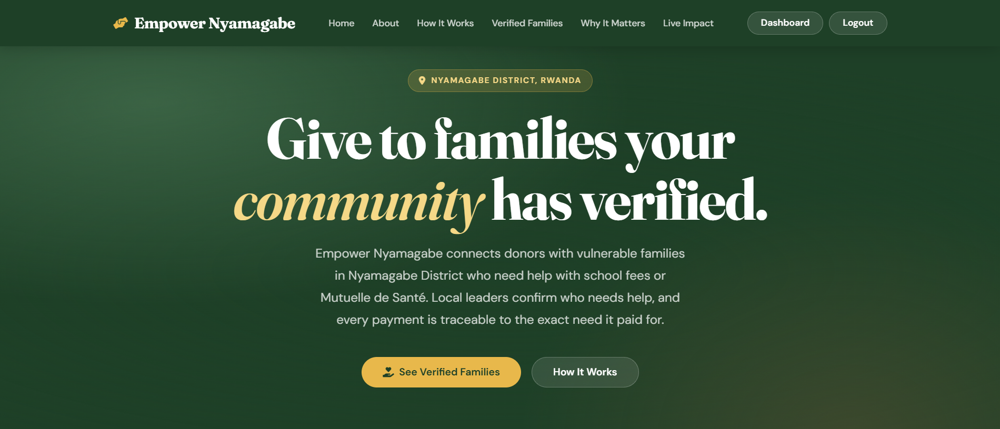 | 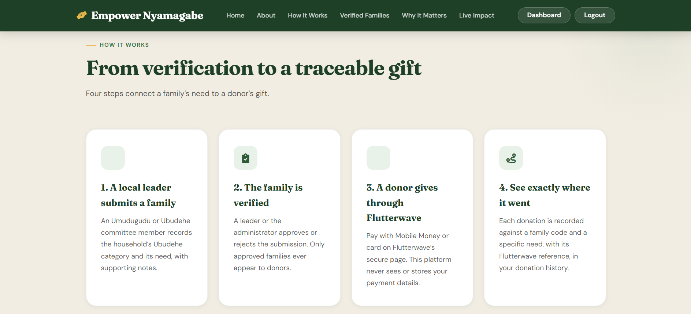 |

| Log in (role selector) | Public Live Impact |
| --- | --- |
| 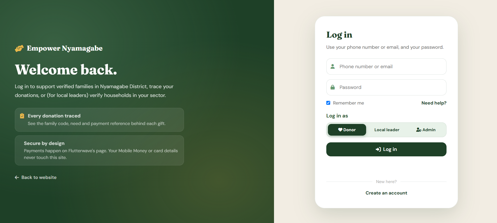 | 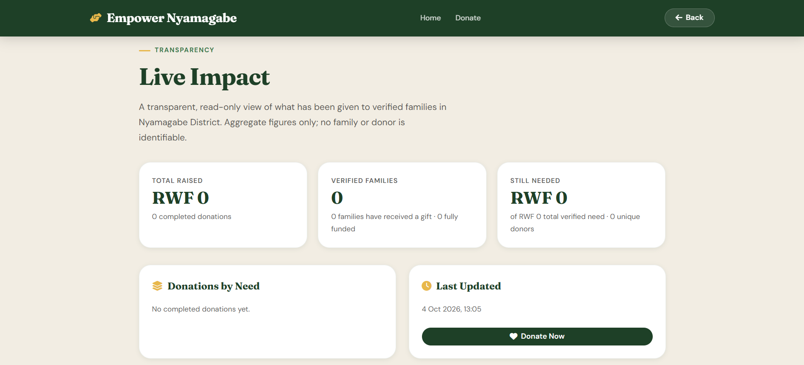 |

| Donor dashboard | Donate form |
| --- | --- |
| 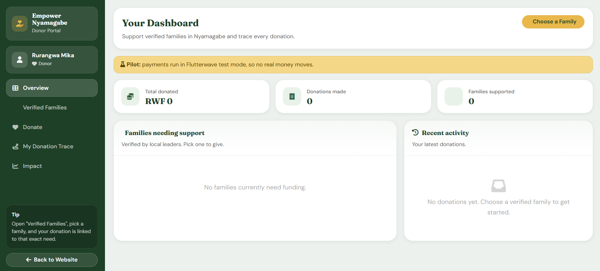 | 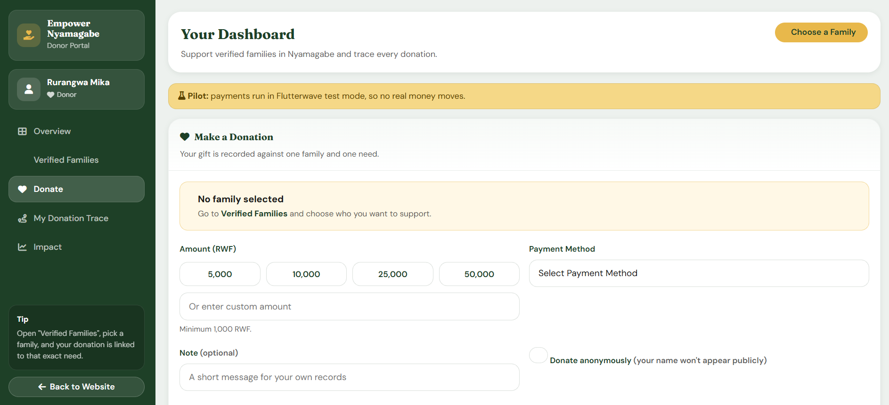 |

**Admin dashboard**

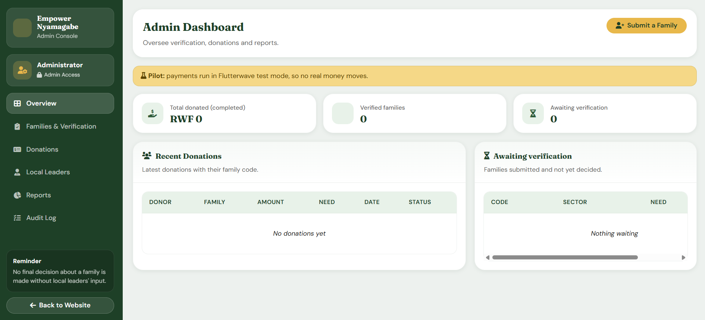

### Navigation and layout decisions

- **One site, three dashboards.** After login, `/?open=dashboard` opens the dashboard that matches the account's role (donor, leader or admin), so users never see menus they cannot use.
- **Persistent left sidebar** inside dashboards (Overview, Verified Families, Donate, My Donation Trace, Impact) with a *Back to Website* button, and a **top navbar** on public pages.
- **Role selector on the login page** (Donor, Local leader, Admin) so each user type is clear from the first screen.
- **Plain-language empty states and a "Pilot" banner** on every dashboard, so users know test mode means no real money moves.
- **Responsive.** Breakpoints at 1024 px, 768 px and 480 px collapse grids to one column and turn the navbar into a hamburger menu.

### System diagrams (from the capstone proposal)

| Architecture | Entity Relationship Diagram |
| --- | --- |
| 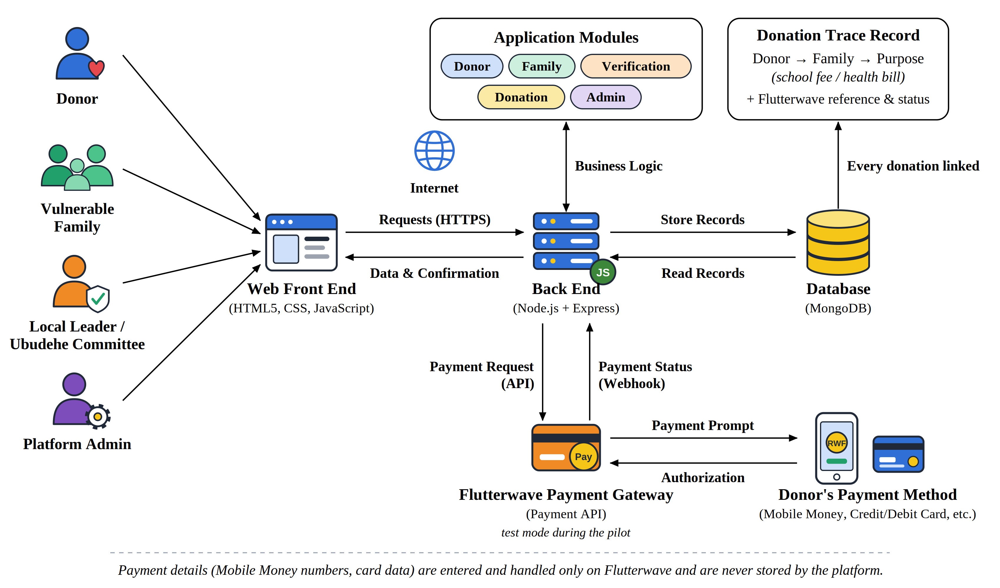 | 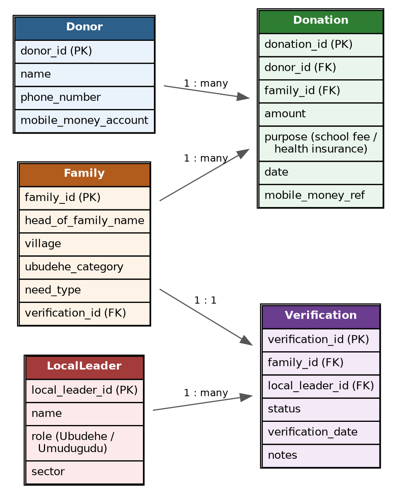 |

| Class diagram | Use case diagram |
| --- | --- |
| 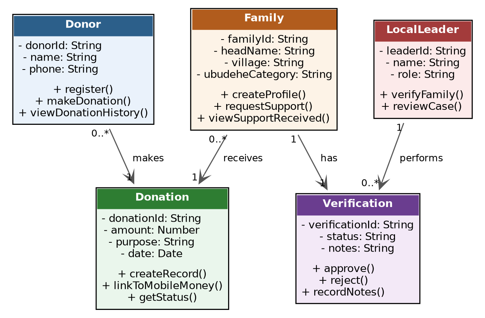 | 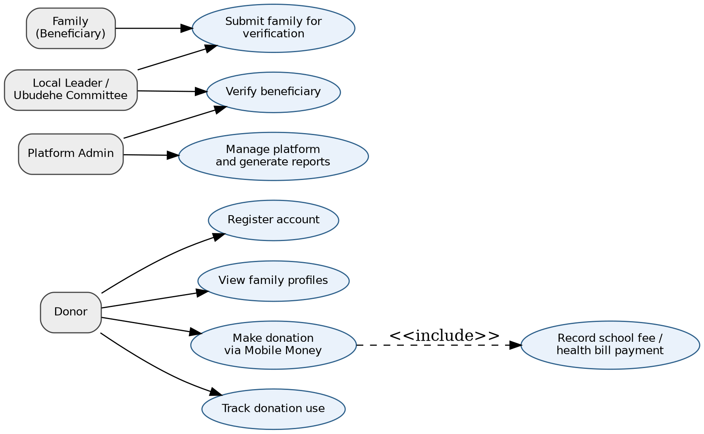 |

### Database schema (implemented)

```
users            id, name, email*, phone*, password_hash, is_admin, role (donor|leader|admin), sector
beneficiaries    id, family_code*, name, phone, sector, cell, village, ubudehe_category,
(families)       household_size, support_type (health|education), need_description, need_amount,
                 notes, verification_status (pending|approved|rejected), submitted_by -> users.id,
                 verified_by -> users.id, verified_at, verification_notes
donations        id, user_id -> users.id, beneficiary_id -> beneficiaries.id, amount, purpose,
(trace record)   payment_method, status (pending|completed|failed), transaction_id (tx_ref),
                 provider_transaction_id, note, is_anonymous
audit_logs       id, actor_user_id -> users.id, action, entity_type, entity_id, details
password_resets  id, user_id -> users.id, token_hash, expires_at, used

* = UNIQUE
```

Relationships: a donor makes many donations; a family receives many donations; a leader submits many families and verifies many families.

---

## 5. Code highlights (selected snippets)

Only a few representative excerpts are shown. The full code is in `server.js` and `public/`.

### 5.1 Back end: role-based access (`server.js`)

```js
function requireLeader(req, res, next) {
  if (!req.user || !(req.user.is_admin || req.user.role === 'leader')) {
    return res.status(403).json({ success: false, message: 'Local leader access required' });
  }
  next();
}
```

### 5.2 Back end: verification rules (`POST /api/families/:id/verify`)

A leader can only decide on families in their own sector, and never on one they submitted. Every decision is written to the audit log.

```js
if (!req.user.is_admin) {
  if (String(fam.sector || '').toLowerCase() !== String(req.user.sector || '').toLowerCase()) {
    return res.status(403).json({ success: false, message: 'You can only verify families in your own sector' });
  }
  if (Number(fam.submitted_by) === Number(req.user.id)) {
    return res.status(403).json({ success: false, message: 'A different leader (or the admin) must verify a family you submitted' });
  }
}
// ... UPDATE beneficiaries SET verification_status = ? ...
logAudit(req.user.id, `family_${newStatus}`, 'beneficiaries', id, { code: fam.family_code, notes });
```

### 5.3 Back end: creating a traceable donation (`POST /api/donations/create`)

Business rules run first, then a `pending` trace record is saved *before* the donor is sent to Flutterwave.

```js
// Business rule: only a VERIFIED family can receive a donation
const family = await dbGet(
  `SELECT b.*, ${FUNDED_SQL} AS funded FROM beneficiaries b WHERE b.id = ?`, [Number(familyId)]);
if (!family || family.verification_status !== 'approved') {
  return res.status(400).json({ success: false, message: 'This family is not verified and cannot receive donations' });
}
const remaining = Math.max(0, Number(family.need_amount) - Number(family.funded));
if (safeAmount > remaining) { /* reject: more than the need still requires */ }

// Create the trace record first (pending until Flutterwave confirms)
const ins = await dbRun(
  `INSERT INTO donations (user_id, beneficiary_id, amount, purpose, payment_method, status, transaction_id, note, is_anonymous)
   VALUES (?, ?, ?, ?, ?, 'pending', ?, ?, ?)`,
  [userId, family.id, safeAmount, purpose, pm, txRef, cleanNote, anonFlag]);
```

### 5.4 Back end: confirming payment with Flutterwave (callback)

The app does not trust the redirect. It asks Flutterwave to verify the transaction and compares reference, amount and currency.

```js
const verified = await verifyFlutterwaveTransaction(flwTransactionId);
const ok =
  verified &&
  String(verified.status).toLowerCase() === 'successful' &&
  String(verified.tx_ref) === String(txRef) &&
  Number(verified.amount) === Number(donation.amount) &&
  String(verified.currency || '').trim().toUpperCase() === 'RWF';
// ok -> status='completed'; otherwise -> status='failed'
```

### 5.5 Back end: privacy-safe public endpoint (`GET /api/families/verified`)

The SQL selects only safe columns, so name, phone, cell, village and notes can never reach the public.

```js
`SELECT b.id, b.family_code, b.sector, b.ubudehe_category, b.support_type, b.need_description,
        b.need_amount, b.verified_at, ${FUNDED_SQL} AS funded
 FROM beneficiaries b
 WHERE b.verification_status = 'approved'`
```

### 5.6 Security setup (`server.js`)

```js
app.use(helmet({ contentSecurityPolicy: { useDefaults: true, directives: {
  "script-src": ["'self'"],               // no inline scripts
  "connect-src": ["'self'", "https:"],
}}}));
const authLimiter = rateLimit({ windowMs: 15 * 60 * 1000, max: 20 });  // login / signup brute-force limit
```

### 5.7 Front end: one API helper with session handling (`public/app.js`)

```js
async function apiCall(endpoint, options = {}) {
  const headers = { 'Content-Type': 'application/json' };
  if (authToken) headers['Authorization'] = `Bearer ${authToken}`;
  const response = await fetch(`${API_BASE}${endpoint}`, { ...options, headers });
  const data = await response.json().catch(() => ({}));
  if (response.status === 401) { showAlert('Your session has expired. Please log in again.', 'error'); logout(false); }
  if (!response.ok || data.success === false) throw new Error(data.message || `Request failed (${response.status})`);
  return data;
}
```

### 5.8 Front end: DOM rendering with XSS protection (`public/app.js`)

Family cards are built from API data, and every value is escaped before it touches the page.

```js
function escapeHtml(value) {
  return String(value ?? '').replace(/&/g, '&amp;').replace(/</g, '&lt;')
    .replace(/>/g, '&gt;').replace(/"/g, '&quot;').replace(/'/g, '&#039;');
}
// familyCardHtml(f) returns <article class="family-card"> ... with a progress bar:
const pct = f.needAmount > 0 ? Math.min(100, Math.round((f.funded / f.needAmount) * 100)) : 0;
```

### 5.9 Front end: responsive CSS (`public/styles.css`)

```css
:root { --forest:#1e4027; --sage:#6a9c74; --gold:#e8b84b; --radius:14px; }

@media (max-width:768px) {
  .hamburger { display:flex }
  .nav-menu  { display:none }
  .dash-shell { grid-template-columns:1fr }   /* sidebar stacks above content */
  .form-modern .form-row { grid-template-columns:1fr }
}
@media (max-width:480px) { .donation-amount { grid-template-columns:repeat(2,1fr) } }
```

### Main API routes

| Route | Who | Purpose |
| --- | --- | --- |
| `POST /api/auth/signup` | public | Create a donor account (phone or email) |
| `POST /api/auth/login` | public | Log in with phone or email |
| `GET /api/families/verified` | public | Anonymous list of verified families |
| `POST /api/families/submit` | leader, admin | Submit a family with supporting notes |
| `GET /api/families/queue` | leader (own sector), admin | Families awaiting or past a decision |
| `POST /api/families/:id/verify` | leader, admin | Approve or reject |
| `POST /api/donations/create` | signed-in user | Start a Flutterwave donation to a verified family |
| `GET /api/donations/user/:id` | owner, admin | Donation trace for one donor |
| `GET /api/donations/receipt/:txRef` | owner, admin | Receipt (also `/pdf`) |
| `POST /api/admin/leaders` | admin | Create a local leader account |
| `GET /api/admin/reports/summary` | admin | Donations and verified-family report |
| `GET /api/admin/export/*.csv\|xlsx` | admin | Donations and families exports |
| `GET /api/admin/audit-logs` | admin | Audit log |
| `GET /api/public/impact` | public | Aggregate figures only |
| `GET /api/health` | public | Health check |

---

## 6. Deployment plan

**Current state:** runs locally (`npm start`) and is demonstrated from `localhost:3000` in test mode.

**Target for the pilot:** a single Node web service on a cloud host with HTTPS, a persistent disk for the SQLite file, and environment variables for secrets. Example with **Render** (Railway or Fly.io work the same way):

| Step | Action |
| --- | --- |
| 1 | Push the repo to GitHub (`.env` and `*.db` are git-ignored). |
| 2 | Create a **Web Service** from the repo. Build command: `npm install`. Start command: `npm start`. |
| 3 | Attach a **persistent disk** (for example mounted at `/var/data`) and set `DB_PATH=/var/data/empower_nyamagabe.db`. SQLite is a file, so without a persistent disk the data is lost on every redeploy. Check the host's current plan limits for disks. |
| 4 | Set environment variables: `NODE_ENV=production`, `JWT_SECRET` (long random), `ADMIN_EMAIL`, `ADMIN_PASSWORD` (strong, not the default), `FLW_SECRET_KEY` (test key during the pilot), `APP_BASE_URL=https://<your-service-url>`. |
| 5 | Set the health check path to `/api/health`. HTTPS is provided by the host. |
| 6 | In the Flutterwave dashboard, allow the site URL and (optionally) set the webhook to `https://<your-service-url>/api/payments/flutterwave/webhook` with the same secret hash as `FLW_WEBHOOK_SECRET_HASH`. |
| 7 | Smoke test: log in as admin, submit and approve a family, make a test donation, open the receipt and `/impact`. |
| 8 | Back up the `.db` file regularly (disk snapshot or scheduled copy). |

**Before any real money:** switch to a live Flutterwave account only after it is approved, change all default credentials, and complete the authorization and data-protection steps listed in the capstone proposal. If the pilot grows, move the data layer to PostgreSQL (the data model stays the same).

---

## 7. Project structure

```
empower_nyamagabe/
├── server.js              Express API, DB schema, auth, donations, verification, reports
├── setup.js               Optional first-time setup helper
├── package.json
├── .env.example           Copy to .env
├── __tests__/             Jest + Supertest API tests
├── public/                Front end (HTML, CSS, JS)
│   ├── index.html         Landing page + donor / leader / admin dashboards
│   ├── login.html  signup.html  reset-password.html
│   ├── impact.html        Public Live Impact page
│   ├── receipt.html       Donation receipt
│   ├── app.js  auth.js  impact.js  receipt.js
│   └── styles.css         Design system (tokens + responsive rules)
└── docs/
    ├── designs/           Screenshots and system diagrams used in this README
    └── DEMO_SCRIPT.md     Script for the 5–10 minute demo video
```

---

## 8. Requirements coverage

| ID | Requirement | Where |
| --- | --- | --- |
| FR1 | Donor signs up and logs in with phone or email | `/signup`, `/login`, `POST /api/auth/*` |
| FR2 | View verified family profiles and their need | Home page, `GET /api/families/verified` |
| FR3 | Donate through Flutterwave and get confirmation | `POST /api/donations/create`, callback, receipt |
| FR4 | Each donation linked to the exact need | `donations.beneficiary_id` + `purpose` |
| FR5 | Local leader submits a family with notes | `POST /api/families/submit` |
| FR6 | Leader or admin approves or rejects | `POST /api/families/:id/verify` |
| FR7 | Donor sees full history and trace | *My Donation Trace* |
| FR8 | Admin reports | *Reports* tab, CSV/Excel export |
| NFR3 | No payment details stored, personal data not public | Hosted checkout, anonymous public API |
| NFR5 | Works on low-cost phones | Responsive layout, no front-end framework |
| NFR6 | Full traceability | Trace record + audit log |

---

## 9. Known limits

Pilot of about 50 participants in one sector; non-probability sampling; test-mode payments only; dependence on internet and smartphone access. Ubudehe can misclassify households, which is why a second person verifies each family and every decision is logged.
